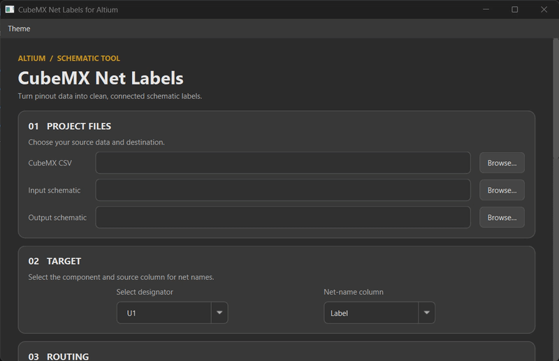

# CubeMX to Altium Net Labels

> [!WARNING]
> **AI-written code.** This tool was written almost entirely by Claude | Co-Pilot, working from my design direction, feedback and bug reports. I've used and tested it on Windows with Altium 26.9.1, but other setups are less tested, so expect rough edges. Treat it like any third-party code: keep backups of your projects and report problems in Issues.

Create Altium schematic net labels from an STM32CubeMX pinout CSV. The app matches package pin numbers to pins on your Altium symbol, then adds wire stubs and labels. Multi-part symbols are supported.

The original schematic can be not overwritten. The generated schematic is saved as a new file.
I recommend insepcting the generated file first then you can overwrite on the original one.

## Run the GUI

Install Python 3.12-3.14, then clone the repository and install its GUI dependencies:

```bash
git clone https://github.com/MBrahim/CubeMX-Altium-Netlabels.git
cd Cubemx-Altium-Netlabels
python -m pip install -e ".[gui]"
```

On Windows, start the GUI with `run_gui.bat`; or from the project folder run:

```bash
python -m cube_netlabels --gui
```

To run the CLI, use a command like this from the project folder, replacing the example paths and designator with your own:

```bash
python -m cube_netlabels pinout.csv board.SchDoc output.SchDoc --designator U1
```

Add `--dry-run` to preview the mapping without writing an output schematic. Select the CubeMX CSV and input `.SchDoc` in the GUI, choose the component designator and options, then generate the output.



## CLI commands

Run commands from the project folder with Python installed:

| Command | Description |
|---|---|
| `python -m cube_netlabels --gui` | Open the graphical interface. |
| `python -m cube_netlabels --list-designators board.SchDoc` | List component designators in a schematic. |
| `python -m cube_netlabels --inspect board.SchDoc --designator U1 [--pin 8]` | Inspect a component or one of its pins. |
| `python -m cube_netlabels pinout.csv board.SchDoc --designator U1 --dry-run` | Preview the pin-to-net mapping without saving a schematic. |
| `python -m cube_netlabels pinout.csv board.SchDoc output.SchDoc --designator U1` | Generate a labeled schematic in a new file. |

Common options:

| Option | Description |
|---|---|
| `-h`, `--help` | Show all available options. |
| `--designator U1` | Select the component to label or inspect. Required for schematic operations. |
| `--column VALUE` | Choose `Label`, `Signal`, or `Name` as the CSV net-name column. Default: `Label`. |
| `--fallback-signal` | Use `Signal` when the selected label is empty. |
| `--fallback-name` | Use the pin name, such as `PA9`, when the selected label is empty. |
| `--dry-run` | Preview the mapping without writing an output schematic. |
| `--grid 100` | Set the endpoint snap grid in mils. |
| `--net-length auto` | Set stub length in mils, or use `auto` to fit the label. |
| `--stub 300` | Set the minimum stub length in mils when using `auto`. |
| `--font-name NAME`, `--font-size N`, `--font-color #RRGGBB` | Set label font appearance. |
| `--font-bold`, `--font-italic`, `--font-underline`, `--font-strikeout` | Apply label font styles. |
| `--leave-unconnected-pins-as-is` | Do not add No ERC markers to unconnected non-power pins. |
| `--exact-pins` | Preserve pin records exactly when saving. |
| `--svg FILE` | Also write an SVG preview. |
| `--pin N` | Select the pin to show with `--inspect`; default: `8`. |

## CSV format

Open the STM32CubeMX project (`.ioc`) and press `Ctrl+U` to generate or update the project. Export the pinout as a CSV file from CubeMX; you can open that CSV in Excel. Use the exported file in this app.

The CSV should include the CubeMX `Position` and `Label` columns. For example:

```csv
Position,Name,Type,Signal,Label
14,PA0,I/O,ADC1_IN0,BTN_1
16,PA2,I/O,USART2_TX,DEBUG_TX
20,PA4,I/O,GPIO_Output,LED_RED
```

- `Position` must match the pin designator in the Altium symbol.
- `Label` is used as the net name. Empty or generic names are skipped.
- Comma, semicolon, and tab-separated files are supported.

[`examples/pinout_example.csv`](examples/pinout_example.csv) shows the expected format.

## Notes

- Inspect the generated schematic in Altium and keep a backup of the original.
- Net-label scope follows the project's **Net Identifier Scope** setting.
- Tested with a 64-pin STM32F103RCT6 multi-part symbol. Other symbols and Altium versions may behave differently.

## License

Licensed under AGPL-3.0-only; see [LICENSE](LICENSE). Built on [altium-monkey](https://github.com/wavenumber-eng/altium_monkey). This project is not affiliated with Altium or STMicroelectronics.
